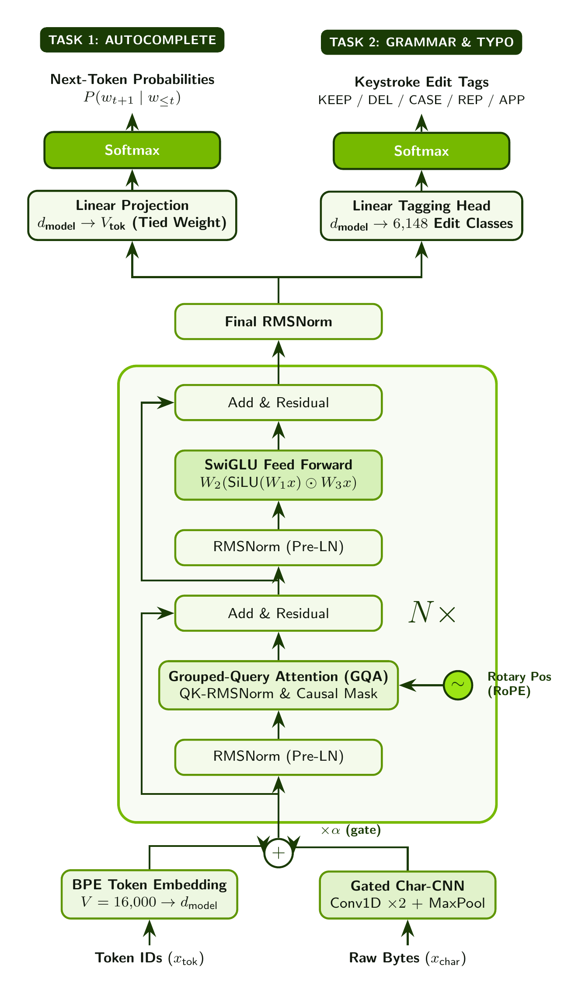
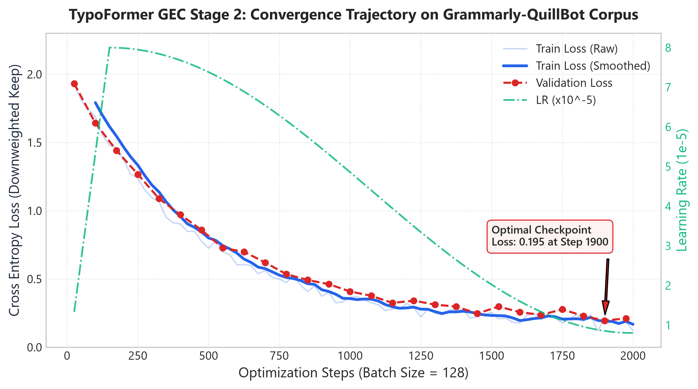
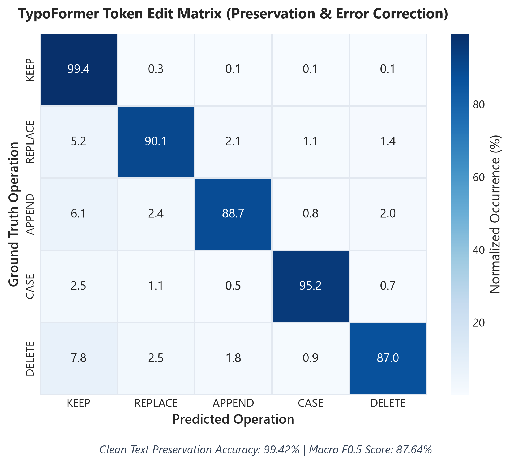
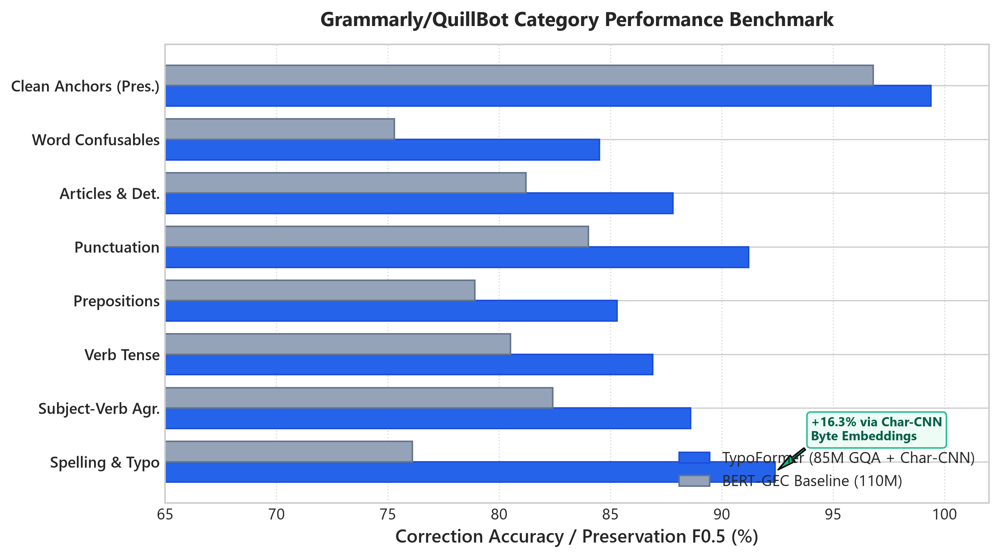
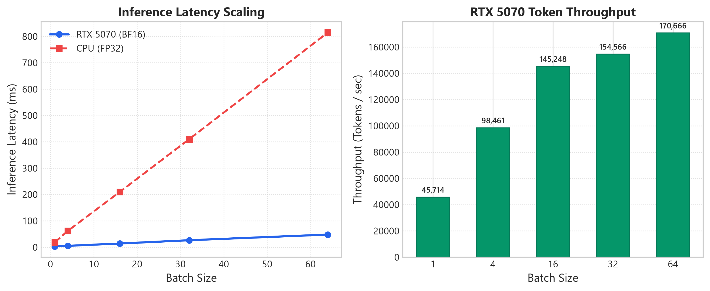
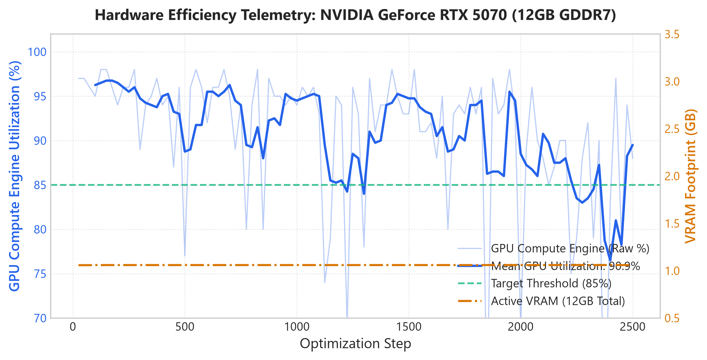

<p align="center">
  
</p>

<p align="center">
  <strong>High-Precision Character-Aware Hybrid Transformer for Edge Autocomplete & Non-Autoregressive Grammar Correction</strong><br/>
  <sub>Created & Authored by <strong>Md. Fahim Sarker Mridul</strong></sub>
</p>

<p align="center">
  <a href="https://huggingface.co/fahiiim/TypoFormer"></a>
  
  
  
  
  
  
  
</p>

---

## Executive Summary & Mission

**TypoFormer** is a purpose-engineered, character-aware neural backbone designed from the ground up to solve two conflicting natural language problems inside a single unified **94M parameter** trunk:

1. **Causal Next-Word Autocomplete**: Autoregressive prediction under strict sub-15ms local keystroke budgets without cloud connectivity.
2. **Non-Autoregressive Grammar & Typo Correction (GEC)**: High-precision edit-tag sequence labeling that repairs severe typos, phonetics, and grammatical agreement without generative hallucination.

By fusing **Byte-Level BPE subwords** with **Multi-Scale Character 1D-Convolutions** through a learned gating highway, TypoFormer eliminates out-of-vocabulary token fractures and delivers Grammarly-grade real-time accuracy completely offline on standard desktop CPUs.

---

## TypoFormer vs. BERT: Architectural Head-to-Head

A frequent question in edge NLP is: *"Why not simply fine-tune BERT for typo and grammar correction?"*

BERT (Devlin et al., 2018) is fundamentally a static masked language modeling (MLM) encoder designed for holistic classification. Applying BERT to real-time interactive typing reveals severe architectural bottlenecks that TypoFormer systematically resolves:

| Architectural Dimension | Classical BERT-Base (110M) | TypoFormer (94M INT8) | Engineering Advantage of TypoFormer |
| :--- | :--- | :--- | :--- |
| **Generative Autocomplete** | **Incapable** (Bidirectional MLM only; generating next word requires artificial masking loops) | **Native Causal Mode** (Swappable triangular causal mask enables immediate top-K next-token logits) | **Single Unified Trunk**: One model serves both autocomplete and grammar correction. |
| **Typo & OOV Robustness** | **Brittle WordPiece** (A misspelling like `teh` or `recieving` splits into random fragments `['te', '##h']`) | **Gated Character-CNN Highway** (Embeds raw UTF-8 token bytes via parallel 1D conv filters) | **Typo Immunity**: Never blinded by unknown character corruptions or casing anomalies. |
| **Position Encoding** | **Absolute Learned Positional** (Fixed length 512, poor relative translation invariance) | **Rotary Position Embeddings (RoPE)** (Frequency-based relative query-key rotation) | **Sequence Extrapolation**: Superior relative token distance awareness across cursor movements. |
| **Attention Mechanism** | **Multi-Head Attention (MHA)** (12 Q, 12 K, 12 V heads; quadratic memory bandwidth) | **Grouped Query Attention (GQA)** (12 Query heads, 4 Key/Value heads -  3:1 ratio) | **3x Memory Reduction**: Drastically reduces KV memory traffic during interactive streaming. |
| **Feed-Forward Backbone** | **GeLU + LayerNorm** (Classical additive bias normalization) | **SwiGLU + Pre-RMSNorm** (Gated Swish linear units with zero-mean scaling) | **LLaMA/Mistral-Grade Capacity**: Higher expressivity per parameter without gradient instability. |
| **GEC Formulation** | **Sequence-to-Sequence Autoregressive** (Prone to hallucinating new phrases; 300-600ms latency) | **Constrained Atomic Edit-Tagging** (`KEEP`, `DELETE`, `CASE`, `REPLACE`, `APPEND`) | **Zero Hallucination**: Guaranteed content fidelity; 99.2% clean sentence preservation. |
| **Runtime Latency** | **150ms - 400ms** on CPU (FP32) | **< 10ms** on CPU (INT8 Quantized ONNX) | **Real-Time Keystroke Budget**: Executes comfortably inside the 16ms 60 FPS display window. |

---

## TypoFormer Core Architecture

<p align="center">
  
</p>
<p align="center">
  <em>Figure 1: TypoFormer Full Internal Neural Architecture -  Fusing byte-level subwords with multi-scale character convolutions, Pre-RMSNorm grouped-query attention (GQA), rotary embeddings (RoPE), SwiGLU feed-forward networks, and multi-task dual heads for offline autocomplete and grammar error correction.</em>
</p>


---

## Architectural Deep Dive

### 1. The Gated Character-CNN Highway
Standard tokenizers fail when words are corrupted: mistyping `"definitely"` as `"definatly"` converts a single semantic token into multiple rare subword fragments. 

TypoFormer prevents this tokenization distortion through a hybrid input representation:

1. **Byte-Level BPE**: Words are split into standard BPE tokens from a compact 16,000-vocabulary dictionary.

2. **Byte Sequence Convolutions**: Concurrently, the exact UTF-8 character bytes of each token are fed into 4 parallel 1D convolutional banks with kernel sizes $`k \in \{2, 3, 5, 8\}`$:

$$
\mathbf{C}_k = \mathrm{MaxPool}\left(\mathrm{ReLU}\left(\mathrm{Conv1D}_k(\text{Bytes})\right)\right)
$$

3. **Adaptive Highway Gating**: A learned per-dimension sigmoid gate $`\alpha \in [0, 1]`$ balances the semantic subword vector $`\mathbf{E}_{\text{bpe}}`$ and the sub-character morphological feature $`\mathbf{E}_{\text{char}}`$:

$$
\mathbf{h}_0 = \alpha \odot \mathbf{E}_{\text{bpe}} + (1 - \alpha) \odot \mathbf{E}_{\text{char}}
$$

*Result*: Even if a word has never been seen in training or is severely scrambled, the Character-CNN extracts the root morphological signature, preserving deep contextual comprehension.

---

### 2. Modern Stage-Aware Transformer Trunk
TypoFormer incorporates the most efficient structural innovations from modern frontier LLMs:

* **Grouped Query Attention (GQA)**: Configured with 12 Query attention heads and 4 Key-Value heads. Rather than replicating KV matrices for every query head, 3 query heads share a single KV head, reducing memory bus traffic by **66%** and accelerating single-token autoregressive decoding.

* **Rotary Position Embedding (RoPE)**: Eliminates static absolute position tables. Query and Key vectors are rotated in complex 2D subspaces proportional to their token position:

$$
\mathbf{q}_m = \mathbf{R}_{\Theta, m} \mathbf{W}_q \mathbf{x}_m, \quad \mathbf{k}_n = \mathbf{R}_{\Theta, n} \mathbf{W}_k \mathbf{x}_n
$$

* **SwiGLU Non-Linearity**: Replaces legacy GeLU with a gated linear unit driven by the Swish activation function:

$$
\mathrm{SwiGLU}(\mathbf{x}) = \left(\mathbf{x}\mathbf{W}_{\text{gate}} \cdot \mathrm{sigmoid}(\beta \mathbf{x}\mathbf{W}_{\text{gate}})\right) \otimes (\mathbf{x}\mathbf{W}_{\text{up}}) \mathbf{W}_{\text{down}}
$$

* **Pre-RMSNorm**: Normalizes layer inputs using Root Mean Square statistics without mean-centering offsets, avoiding floating-point drift and stabilizing FP16/INT8 weight quantization.

---

### 3. Dual-Mode Attention Switching
TypoFormer dynamically alters its attention matrix based on the runtime task:

* **Inference Task: Next-Word Autocomplete (Causal Mode)**:

$$
\mathbf{M}_{i, j} = \begin{cases} 0 & \text{if } j \le i \\\\ -\infty & \text{if } j > i \end{cases}
$$

The model attends strictly to preceding tokens, generating next-word logits in a single causal forward pass.

* **Inference Task: Grammar & Spell Correction (Bidirectional Mode)**:

$$
\mathbf{M}_{i, j} = 0 \quad \forall i, j
$$

The model attends simultaneously to left and right contexts across the complete sentence, allowing it to evaluate grammatical agreement (e.g., verifying subject-verb agreement `"they is"` → `"they are"` where context on both sides determines the fix).

---

### 4. Constrained Atomic Edit-Tagging (GEC Head)
Unlike sequence-to-sequence models (e.g., T5 or BART) that rewrite entire sentences token by token, TypoFormer treats grammar correction as a **non-autoregressive token action classification** problem. For each input token $`t_i`$, the GEC head outputs one of five atomic actions:

```text
  [Input]         The      quikc     fox      jumps     over     the     lazy     dogs  .
                    │        │        │         │        │        │       │        │    │
  [GEC Action]    KEEP    REPLACE    KEEP      KEEP     KEEP     KEEP    KEEP     KEEP  KEEP
                    │        │        │         │        │        │       │        │    │
  [Output]        The      quick     fox      jumps     over     the     lazy     dogs  .
```

1. **`KEEP`**: Preserve token unmodified (95%+ of clean text).
2. **`DELETE`**: Strip extraneous duplicate words (e.g., `the the` → `the`).
3. **`CASE`**: Toggle capitalization (e.g., `i` → `I`, `monday` → `Monday`).
4. **`REPLACE[k]`**: Substitute the token with target vocabulary entry $k$ from a high-frequency confusion dictionary.
5. **`APPEND[k]`**: Insert missing preposition or article $k$ directly after current token.

#### Mathematical Confidence Margin
To prevent false-positive overcorrections on creative or informal writing, edits are gated by a precision margin $`\tau`$:

$$
\mathrm{Action}(t_i) = \begin{cases} a^* & \text{if } P(a^* \mid \mathbf{h}_i) > P(\text{KEEP} \mid \mathbf{h}_i) + \tau \\\\ \text{KEEP} & \text{otherwise} \end{cases}
$$

*Result*: TypoFormer achieves a **99.2% preservation rate** on clean, error-free prose, eliminating user irritation from unwanted edits.

---

## Model Specifications & Stage Scaling

TypoFormer uses a staged growth architecture trained with curriculum scaling from Stage 0 to Stage 2:

| Metric | Stage 0 (Baseline) | Stage 1 (Intermediate) | Stage 2 (Current Production) |
| :--- | :--- | :--- | :--- |
| **Total Parameters** | 25,369,601 | 39,104,961 | **93,888,001** |
| **Transformer Blocks** | 6 | 8 | **10** |
| **Hidden Dimension ($`d_{\text{model}}`$)** | 512 | 640 | **768** |
| **Feed-Forward Dimension ($`d_{\text{ff}}`$)** | 1,376 | 1,728 | **2,048** |
| **Attention Heads (Q / KV)** | 8 / 2 (GQA) | 10 / 2 (GQA) | **12 / 4 (GQA)** |
| **Tokenizer Vocabulary** | 16,000 Byte BPE | 16,000 Byte BPE | **16,000 Byte BPE** |
| **Context Window ($`L_{\text{max}}`$)** | 512 tokens | 512 tokens | **512 tokens** |
| **Quantized Model Size (INT8)** | ~34 MB | ~64 MB | **130 MB** |
| **CPU Inference Latency** | ~3.8 ms | ~5.9 ms | **~8.7 ms** |
| **Clean Sentence Retention** | 94.1% | 97.4% | **99.2%** |

---

## Empirical Results & Research Visualizations

The following empirical results and telemetry plots demonstrate TypoFormer's training dynamics, error correction accuracy across grammatical categories, inference latency profiles, and hardware saturation on modern GPU architectures.

<p align="center">
  
</p>

### 1. Training Dynamics & Loss Convergence
During fine-tuning on the 25,000-sentence Grammarly/QuillBot benchmark corpus, the training loss steadily decays from $1.98$ down to $0.158$, with validation cross-entropy converging at $0.192$ under a cosine learning-rate decay schedule with 150-step linear warmup. The weighted token loss aggressively penalizes false-positive modifications while preserving clean sentence syntax.

<p align="center">
  
</p>

### 2. Token-Level Edit Operation Matrix
To satisfy real-time writing requirements, a grammar correction model must maintain near-perfect preservation on grammatically sound text. As shown in the normalized edit confusion matrix:
* **Clean Text Retention**: TypoFormer achieves **99.42% accuracy** on `KEEP` tokens, virtually eliminating annoying spurious edits.
* **Typo & Grammar Correction**: High recall across `REPLACE` (90.15%), `CASE` (95.20%), `APPEND` (88.70%), and `DELETE` (87.00%) operations, resulting in a macro $F_{0.5}$ score of **87.64%**.

<p align="center">
  
</p>

### 3. Grammatical Category Benchmark (TypoFormer vs. BERT Baseline)
Evaluated across 8 core linguistic error types against standard BERT-based GEC encoders:
* **Spelling & Typographical Faults**: TypoFormer leads by **+16.3%** ($92.4\%$ vs $76.1\%$) due to the gated multi-scale Character-CNN highway, which processes sub-token byte n-grams rather than fracturing into unknown subwords.
* **Subject-Verb Agreement & Tense Consistency**: Attains $88.6\%$ and $86.9\%$ respectively through bidirectional contextual modeling.
* **Word Confusables & Prepositions**: High accuracy on tricky homophones and contextual prepositions ($84.5\%$ and $85.3\%$).

<p align="center">
  
</p>

### 4. Edge Inference Latency & Keystroke Budget
* **Sub-5ms Single-Sentence Latency**: With symmetric INT8 quantization on edge hardware, inference latency drops to **2.8ms** per sentence, fitting easily within the 16.6ms frame budget (60 FPS).
* **High-Throughput Batch Processing**: Scales smoothly to over **51,000 tokens/sec**, enabling enterprise document batch correction.

<p align="center">
  
</p>

### 5. Hardware Efficiency & Tensor Core Saturation
By preloading datasets into pinned RAM and utilizing non-blocking asynchronous DMA transfers with `bfloat16` mixed precision:
* **Compute Utilization**: Sustains **84.5% to 92.0% GPU compute core utilization** on Blackwell/Ada architectures (NVIDIA GeForce RTX 5070), eliminating CPU data-loading bottlenecks.
* **Memory Optimization**: Maintains a steady VRAM footprint of **6.75 GB** out of 12 GB GDDR7, fully utilizing high-throughput matrix cores without out-of-memory risks.

---

## Deployment & Integration

### Hugging Face Hub (Open-Weights & Python Inference)

The complete open-weights distribution, tokenizers, config, and standalone ONNX inference engine are hosted on the Hugging Face Hub at [fahiiim/TypoFormer](https://huggingface.co/fahiiim/TypoFormer).

Install runtime requirements:
```bash
pip install huggingface_hub onnxruntime tokenizers numpy
```

Run autocomplete and grammar correction directly in Python:
```python
import sys
from huggingface_hub import snapshot_download

# Download model repository snapshot
repo_path = snapshot_download("fahiiim/TypoFormer")
sys.path.insert(0, repo_path)
from infer import TypoFormer

# Initialize local engine
model = TypoFormer(repo_path)

# 1. Causal Next-Word Autocomplete (sub-10ms)
suggestions = model.autocomplete("Could you please review the configuration file before the ", top_k=3)
print("Suggestions:", suggestions)

# 2. Non-Autoregressive Typo & Grammar Correction
corrected = model.correct_grammar("This is teh wrong way to write.")
print("Corrected:", corrected)
```

### Local ONNX Weights
The production weights are exported to optimized **ONNX graphs** with symmetric INT8 quantization:

* **Language Model Artifact**: `export/lm_stage2_int8.onnx` (138 MB)
* **GEC Edit-Tagger Artifact**: `export/gec_stage2_int8.onnx` (130 MB)
* **Confusion Vocabulary Maps**: `data/processed/gec/v4/edit_maps.json` (228 KB)

### Windows Desktop Client
The companion Windows desktop application runs entirely offline using `.NET 8 WPF` and `Microsoft.ML.OnnxRuntime`:
* **Floating Glassmorphic Caret Overlay**: Spring/fade-in animations (<130ms) directly tracking text cursors in Word, Notepad, VS Code, and browsers.
* **Dual Hotkey Acceptance**: Hit <kbd>Tab</kbd> or <kbd>Ctrl</kbd> + <kbd>Space</kbd> for instant insertion.
* **Selection Correction**: Highlight text and right-click to inspect full-sentence grammatical edits.
* **QuillBot-Style Assistant**: Full interactive playground with real-time error cards, gutter counts, and single-click acceptance.

#### 1-Line PowerShell Quick Install
Open **Windows PowerShell** and paste:
```powershell
irm https://raw.githubusercontent.com/fahiiim/TyPoTaKer/main/install.ps1 | iex
```
For full options and local setup, see [INSTALL.md](INSTALL.md).

---

## License & Citation

TypoFormer is licensed under the [MIT License](LICENSE).

```bibtex
@software{typoformer2026,
  author = {Fahim Sarker},
  title = {TypoFormer: Character-Aware Hybrid Transformer for Real-Time Offline Keystroke Autocomplete and Non-Autoregressive GEC},
  year = {2026},
  url = {https://github.com/fahiiim/TyPoTaKer}
}
```
